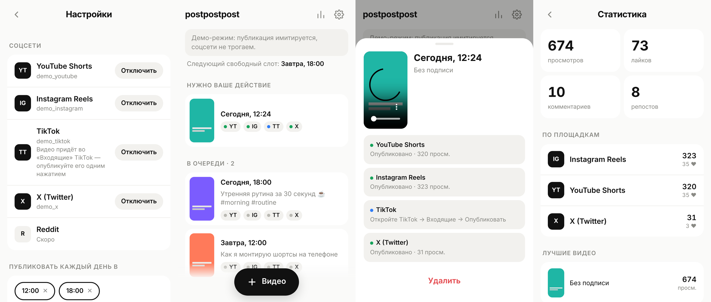

# postpostpost

Свой сервис автопостинга коротких видео: **YouTube Shorts, Instagram Reels, TikTok, X**.
Кидаете видео — оно выходит во все сети в ближайший слот расписания. Статистика собирается сама.



**Демо интерфейса:** https://serezhaok.github.io/postpostpost/ — работает прямо в браузере. Публикация там имитируется, ваши соцсети не трогаются.

## Как пользоваться

1. **«+ Видео»** → выбрать ролик → **«Запланировать»**. Всё.
   Подпись необязательна. Загрузка на сервер начинается сразу, пока вы пишете текст.
2. На Android приложение появляется в меню **«Поделиться»**: из галереи — в postpostpost, затем одно нажатие.
3. Видео встаёт в **ближайший свободный слот** (например, каждый день в 12:00 и 18:00 — задаётся в настройках).
   Можно и «Сейчас», и на конкретное время.
4. В карточке поста видно статус по каждой сети, ссылки на опубликованное, ошибки и кнопку «Повторить».
5. «Статистика»: просмотры, лайки, комментарии, репосты — суммарно, по сетям и лучшие видео.

Работает в браузере на компьютере и на телефоне. На телефоне его можно добавить на главный экран, это PWA.

## Запуск на сервере

Одна команда на чистом VPS с Ubuntu. Подробности — в [deploy/README.md](deploy/README.md).

```bash
curl -fsSL https://raw.githubusercontent.com/serezhaOk/postpostpost/main/deploy/install.sh | sudo bash
```

Скрипт ставит Docker, запускает приложение и Caddy (тот сам выпускает HTTPS-сертификат), затем показывает адрес и пароль.
Данные (база SQLite и видео) хранятся на сервере, токены и ключи — в зашифрованном виде (AES-256-GCM).

Локально, без Docker: нужен Node.js 22.5+, `npm install` не нужен.

```bash
npm run dev          # демо-режим: соцсети имитируются
```

## Подключение соцсетей

Всё делается в интерфейсе: ⚙️ Настройки → **«Настроить»** у нужной соцсети.
Там пошаговая инструкция, адрес возврата копируется кнопкой, ключи вставляются в форму.
После сохранения сразу открывается вход в соцсеть.

Ключи — это бесплатное приложение разработчика, которое вы создаёте в своём аккаунте каждой соцсети. Что важно знать:

| Соцсеть | Ограничение |
|---|---|
| YouTube | Пока проект не прошёл бесплатный аудит YouTube API, загруженные видео приватные. Квота — около 6 загрузок в сутки. |
| Instagram | Нужен профессиональный аккаунт (Автор или Бизнес). Свой аккаунт добавляется тестировщиком, проверка Meta не нужна. |
| TikTok | Без аудита — через «Входящие», см. ниже. |
| X | Публикация через API платная. |
| Reddit | В планах. |

Ключи можно задать и в `.env` (см. `.env.example`); заданные в интерфейсе важнее.
Если соцсеть отозвала доступ, аккаунт помечается «Доступ истёк», и приходит уведомление — достаточно нажать «Переподключить».

### TikTok: почему «Входящие»

Пока приложение не прошло аудит, TikTok разрешает публиковать через API только **приватные** видео.
Сделать видео публичным позже через API нельзя: метода для смены видимости нет.
Поэтому по умолчанию (`TIKTOK_MODE=inbox`) в момент слота видео отправляется во **«Входящие» TikTok**.
Вам приходит уведомление в Telegram, вы открываете TikTok и нажимаете «Опубликовать».

После аудита ставите `TIKTOK_MODE=direct` — и видео сразу выходят публично, без вашего участия.

## Демо на GitHub Pages

GitHub Pages раздаёт только статические файлы, поэтому там лежит не сервер, а интерфейс с имитацией бэкенда (`demo/demo.js`).
Сборка: `sh scripts/build-demo.sh`. При пуше в `main` workflow `.github/workflows/pages.yml` выкладывает демо автоматически.
Реальному автопостингу всё равно нужен свой сервер (см. выше).

## Устройство

```
server/
  index.js        HTTP-сервер, API, OAuth, раздача файлов
  scheduler.js    каждые 15 секунд: публикация, проверка обработки, повторы, сбор статистики
  db.js           SQLite (встроен в Node): посты, задачи по площадкам, аккаунты, настройки
  time.js         слоты расписания в часовом поясе пользователя
  platforms/      по модулю на площадку: authUrl, connect, refresh, publish, check, stats
public/           интерфейс: один экран, без сборки, PWA + Share Target
```

Каждый пост раскладывается на задачи по площадкам. Статусы задачи:
`pending → running → processing → done`.
У TikTok в режиме inbox есть ещё `draft`, при ошибке — `failed`.
Ошибки повторяются 3 раза с паузой, затем приходит уведомление.

```bash
npm test
```
